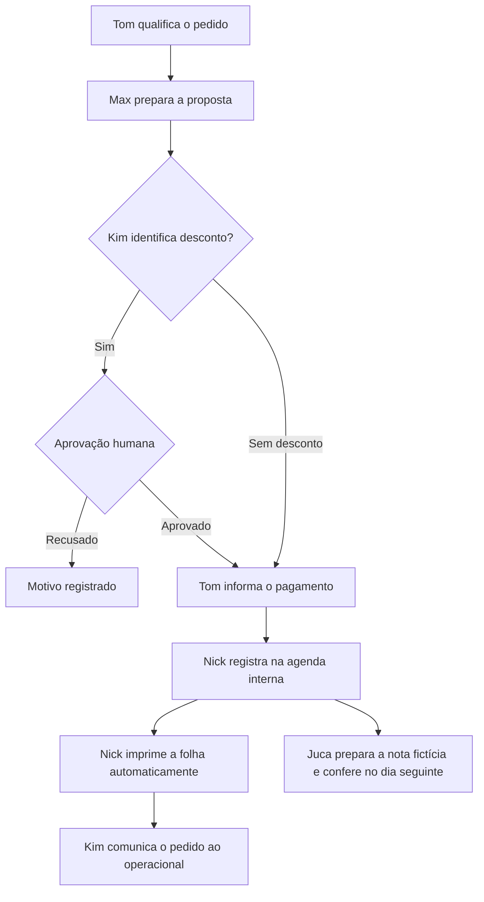

# Corte de Agentes

**Estudo de caso de Rejane Dantas · Coordenação de agentes de IA com aprovação humana**

Desenhei um fluxo para dividir tarefas de atendimento, vendas e operação entre agentes especializados. Cada passagem registra quem assume a tarefa, a prioridade, o prazo e a fonte dos dados. As duas demonstrações documentam o desenho do projeto com cenários e dados fictícios.

## Comece pela correção de cardápio

Kim registra a solicitação e repassa a tarefa a Nick, que confere o preço publicado e guarda uma imagem do antes. A responsável aprova ou recusa a proposta. Se aprovada, Nick altera o preço, relê o portal e registra o depois. Se recusada, o preço fica como está e o motivo fica registrado.

[Ver o diagrama de correção de cardápio](diagramas/correcao-cardapio.webp)

## Do pedido ao caixa

A demonstração acompanha um pedido fictício de 30 cestas. Tom qualifica o pedido, Max prepara a proposta com preços de uma API fictícia de somente leitura e Kim confere as regras. Se houver desconto, a proposta aguarda aprovação humana.

O registro na **agenda interna** começa quando Tom informa que o cliente pagou. Nick é a responsável por lançar o pedido e imprimir a folha automaticamente. A equipe operacional consulta a agenda e recebe as informações do pedido pela Kim, no canal de acompanhamento diário. Na etapa fiscal da demo, Juca prepara a nota fictícia e confere o registro no dia seguinte. Se encontrar divergência, registra a correção na mesma issue.

## Decisões de design

| Decisão | Como aparece nos fluxos |
| --- | --- |
| Aprovação humana | A decisão fica registrada para descontos na proposta e mudanças de preço no portal. |
| Responsabilidade por recurso | Nick é a responsável por registrar pedidos na agenda interna. O operacional consulta a agenda, e a demo prevê uma trava contra gravações simultâneas. |
| Passagem rastreável | Cada bilhete registra responsável, prioridade, prazo e fonte no log de passagens. |
| Fonte de referência | A proposta consulta a API de preços. A correção de cardápio começa pela leitura do valor publicado. |
